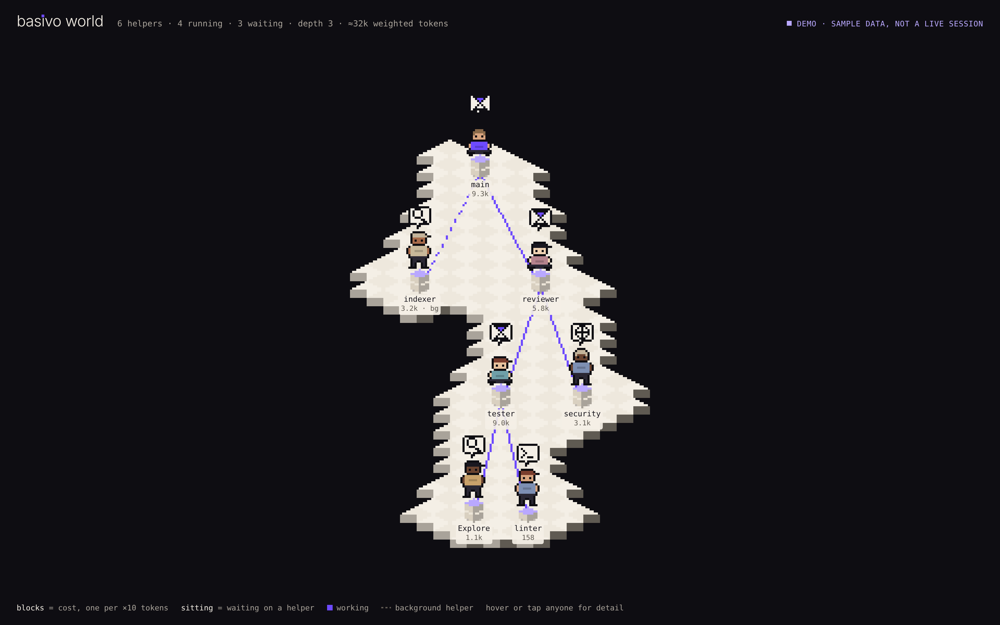
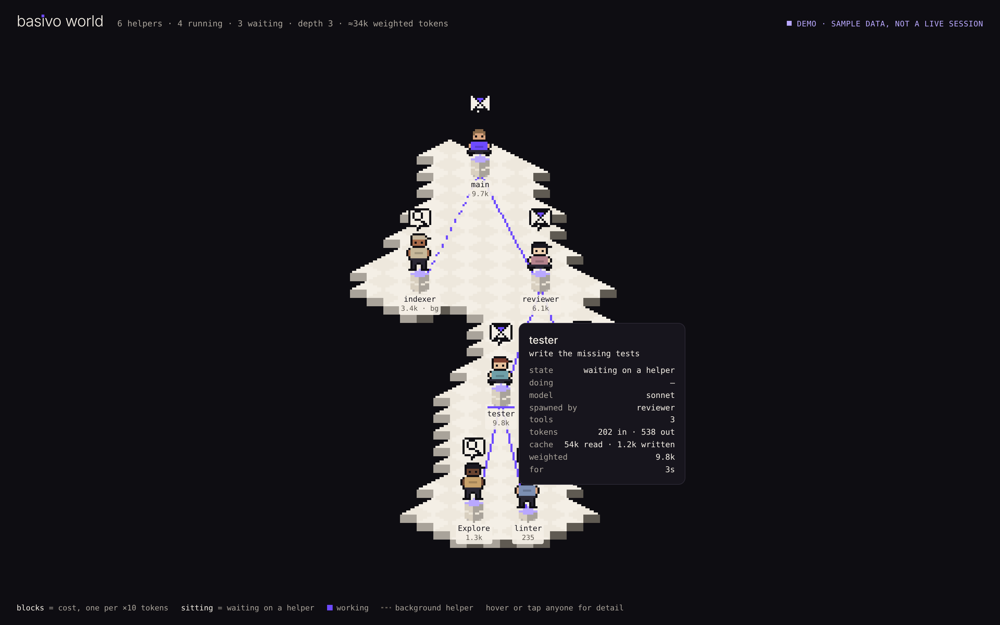

# basivo-world

See your Claude Code agents, live. Who spawned whom — at any depth — what each one is
doing right now, and what it is costing you.



When Claude delegates, it spawns helpers, and helpers can spawn their own. In the terminal
all you see is a spinner. basivo-world shows the crew: a live tree in a pane beside your
chat, and a pixel-art island in your browser where every agent is a character.

## Install

```
/plugin marketplace add mohamedabubasith/basivo-plugins
/plugin install basivo-world@basivo
```

Needs Claude Code **2.1.287 or later** (it is a mod). Nothing else: no server, no port,
no Docker, no Python.

## Use

You don't have to do anything. The **pane opens by itself the first time Claude
delegates**, and never in a session that delegates nothing:

```
3 helpers · 2 running · 2 waiting · depth 2 · ≈45k weighted tokens
◐ main  waiting on a helper  21k
├─ ● indexer  Glob  3.2k
└─ ◐ reviewer  waiting on a helper  12k
   └─ ● tester  Bash  9.0k
/world opens the pixel-art view in your browser.
```

**`/world`** opens the pixel-art view in your browser. It is a local file that re-reads
the session's state every half-second; it keeps working as long as the session does.

**Try it without a session:** open `web/index.html?demo` in a browser. It plays a scripted
crew, and says so in the corner — demo data is never shown as live.

## Reading the world

| What you see | What it means |
| :- | :- |
| A character | One agent. Same outfit for the same agent type, so you learn to spot the reviewer. |
| **Violet shirt** | Main — your session, the orchestrator. Violet means nothing else. |
| **Stack of blocks** under them | Cost: one block per ×10 cost-weighted tokens. Who's expensive, at a glance. |
| Bobbing, with a tool in the bubble | Working, and on what: search, edit, shell, web, a helper, an MCP tool. |
| **Sitting, hourglass** | Waiting on a helper it spawned. Not busy — blocked. |
| Clock in the bubble | Quiet for 90s or more. Usually one long request thinking; not necessarily stuck. |
| Faded, violet check | Done. |
| Red ✗ | Failed. |
| Line to another character | Who spawned whom. **Dashed** for a background helper, which doesn't block its parent. |
| A small packet travelling up a line | A helper handing its result back — the one real conversation between agents. |
| No line, `?` under the name | Its spawner was never seen (say, it started before a reload). Shown unattached, never guessed. |

Hover or tap anyone for the detail: their task, model, tools used, and tokens split into
input, output, cache read and cache written.



## Why it is built this way

**It sees every depth.** Every other tool for watching Claude Code agents is built on
settings hooks — and in our test those never fired for a helper's helper: a nested
subagent produced no `SubagentStart` and no `SubagentStop` at all, though the session's
own event stream showed it running. basivo-world is a mod,
so it reads the engine's own `agentId` and `parentAgentId` on every event and polls the
engine's roster of agents. Nested helpers appear where they belong.

**It is honest about what it doesn't know.** A parent it never saw is drawn as unknown,
not invented. Usage from the engine's own internal work, such as compaction, is counted
in the totals but never drawn as a character that doesn't exist. A snapshot that has gone
stale says "no events for 2m" rather than "live".

**Waiting is not working.** A parent blocked on a helper is drawn sitting, not busy.
That's the difference between "four agents working" and "one agent working while three
wait on it", which is what you usually want to know.

**It is read-only.** It never holds, changes, or answers a tool call or a permission
prompt. If its own code fails, Claude carries on as if it weren't installed.

**Cost without a price list.** Tokens are weighted by Anthropic's published ratios
(output 5×, cache write 1.25×, cache read 0.1× of fresh input). That ranks who is
expensive without quoting dollars from a price table that would quietly go stale.

## What it writes, and where

Only after you run `/world`, and only on your machine:

```
~/.claude/basivo-world/<session id>/
  index.html  world.js  sprites.js  demo.js   the page
  state.js                                      the agent tree, rewritten as it changes
```

`state.js` holds agent types, **the task each helper was given**, tool names, models and
token counts. Task descriptions can contain whatever you asked Claude to do, so treat the
folder as you would your session transcripts. Nothing is sent anywhere. Delete the folder
whenever you like.

## Limits, plainly

- **Not yet run in a live interactive session.** It is verified against the engine's own
  test harness, type-checked against this Claude Code build's full API, and its browser
  view is tested in Chromium against the real model's output. The first real session is
  still the real test — please open an issue with what you see.
- **Mods are early access.** The API it is built on may change between Claude Code
  releases.
- **Where it draws:** the pane appears in the terminal, the Desktop app and VS Code. In
  `claude -p` and cloud sessions its hooks run but nothing draws, and the browser view
  needs a browser on the same machine.
- **"Quiet" is not "stuck."** One long request with deep thinking has no events inside
  it. The clock appears after 90 seconds of silence and means exactly that.
- Up to 150 agents are kept; past that, the oldest finished ones are dropped first.

## Tests

```bash
claude plugin validate .                 # the manifest and what the mod hooks and calls
claude plugin test .                     # the mod, driven through the engine's harness
node tests-browser/demo.cjs              # the page in Chromium: 3 sizes, 2 themes
node tests-browser/live.cjs              # the page against the real model's snapshots
```

The browser tests need Playwright.

## Licence

MIT
