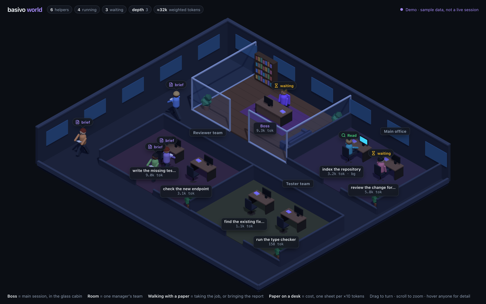
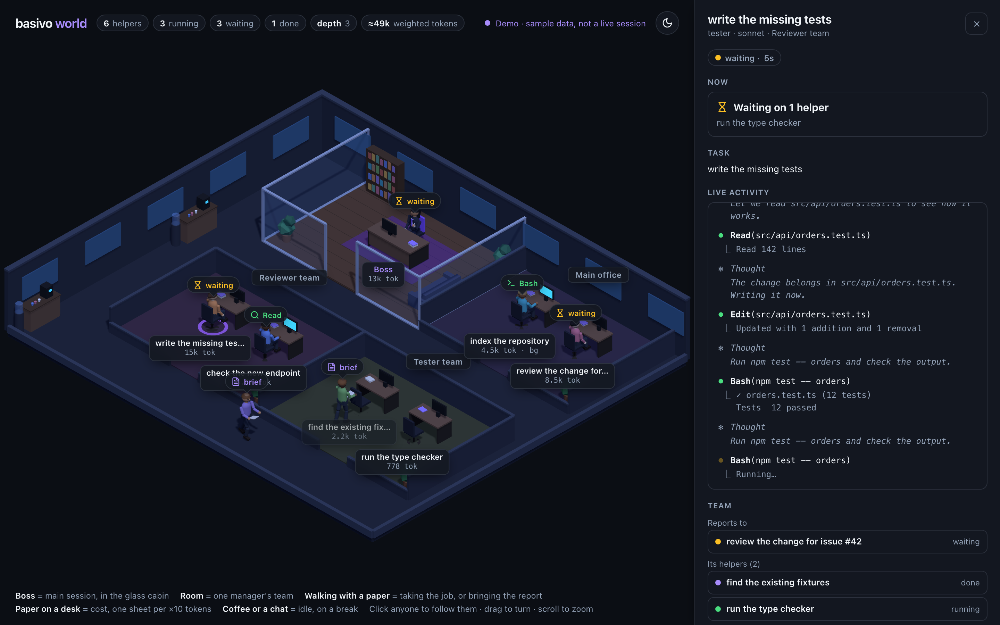

# basivo-world

See your Claude Code agents, live. Who spawned whom — at any depth — what each one is
doing right now, and what it is costing you.



When Claude delegates, it spawns helpers, and helpers can spawn their own. In the terminal
all you see is a spinner. basivo-world shows the crew: a live tree in a pane beside your
chat, and a 3D office in your browser. Main is the boss, in a cabin of
its own; each manager's helpers share a room. A helper takes the job at its manager's
desk, walks through the corridors to its room, works there, and walks the report back.

## Install

```
/plugin marketplace add mohamedabubasith/basivo-plugins
/plugin install basivo-world@basivo
```

Needs Claude Code **2.1.287 or later** (it is a mod). Nothing else: no server, no port,
no Docker, no Python.

## Use

You don't have to do anything. The **pane opens by itself the first time Claude
delegates**, and never in a session that delegates nothing:

```
3 helpers · 2 running · 2 waiting · depth 2 · ≈45k weighted tokens
◐ main  waiting on a helper  21k
├─ ● indexer  Glob  3.2k
└─ ◐ reviewer  waiting on a helper  12k
   └─ ● tester  Bash  9.0k
/world opens the 3D office in your browser.
```

**`/world`** opens the 3D office in your browser. It is a local file that re-reads
the session's state every half-second; it keeps working as long as the session does.

**Try it without a session:** open `web/index.html?demo` in a browser. It plays a scripted
crew, and says so in the corner — demo data is never shown as live.

## Reading the world

| What you see | What it means |
| :- | :- |
| **The glass cabin** | The boss: main, your session, at the big desk with the bookshelf. Violet shirt and a crown. |
| **A room** | A department: one manager's helpers, one desk each. The sign says whose: "Main office" reports straight to the boss, "Reviewer team" to the reviewer. |
| A person at a desk | One agent. Same shirt colour for the same agent type, so you learn to spot the reviewer. |
| **Screen on, typing**, tool in the bubble | Working, and on what: search, edit, shell, web, a helper, an MCP tool. |
| **Hourglass**, screen off | Waiting on helpers it spawned. Not busy — blocked. |
| **Clock** in the bubble | Quiet for 90s or more. Usually one long request thinking; not necessarily stuck. |
| **Walking in with a paper** ("brief") | Just spawned: it took the job at its manager's desk and is walking the corridors to its own. |
| **Walking back with a paper** ("report") | Done (or ✗ failed): it hands the report in at its manager's desk, and the paper joins the stack there. |
| **Paper on a desk** | Cost: one sheet per ×10 cost-weighted tokens. The second stack on a manager's desk is reports in. |
| `bg` on the name tag | A background helper, which doesn't block its manager. |
| `?` on the name tag | Its spawner was never seen (say, it started before a reload). It sits in the main office and reports to no one, never a guessed manager. |

Drag to turn the building, scroll to zoom, double-click to reset.

Hover or tap a desk for the detail: their task, model, tools used, and tokens split into
input, output, cache read and cache written.



## Why it is built this way

**It sees every depth.** Every other tool for watching Claude Code agents is built on
settings hooks — and in our test those never fired for a helper's helper: a nested
subagent produced no `SubagentStart` and no `SubagentStop` at all, though the session's
own event stream showed it running. basivo-world is a mod,
so it reads the engine's own `agentId` and `parentAgentId` on every event and polls the
engine's roster of agents. Nested helpers appear where they belong.

**It is honest about what it doesn't know.** A parent it never saw is drawn as unknown,
not invented. Usage from the engine's own internal work, such as compaction, is counted
in the totals but never drawn as an agent that doesn't exist. A snapshot that has gone
stale says "no events for 2m" rather than "live".

**Waiting is not working.** A parent blocked on a helper sits with its monitor off and an hourglass, not busy.
That's the difference between "four agents working" and "one agent working while three
wait on it", which is what you usually want to know.

**It is read-only.** It never holds, changes, or answers a tool call or a permission
prompt. If its own code fails, Claude carries on as if it weren't installed.

**Cost without a price list.** Tokens are weighted by Anthropic's published ratios
(output 5×, cache write 1.25×, cache read 0.1× of fresh input). That ranks who is
expensive without quoting dollars from a price table that would quietly go stale.

## What it writes, and where

Only after you run `/world`, and only on your machine:

```
~/.claude/basivo-world/<session id>/
  index.html  world.js  demo.js  three.min.js   the page
  state.js                                      the agent tree, rewritten as it changes
```

`state.js` holds agent types, **the task each helper was given**, tool names, models and
token counts. Task descriptions can contain whatever you asked Claude to do, so treat the
folder as you would your session transcripts. Nothing is sent anywhere. Delete the folder
whenever you like.

## Limits, plainly

- **Not yet run in a live interactive session.** It is verified against the engine's own
  test harness, type-checked against this Claude Code build's full API, and its browser
  view is tested in Chromium against the real model's output. The first real session is
  still the real test — please open an issue with what you see.
- **Mods are early access.** The API it is built on may change between Claude Code
  releases.
- **Where it draws:** the pane appears in the terminal, the Desktop app and VS Code. In
  `claude -p` and cloud sessions its hooks run but nothing draws, and the browser view
  needs a browser on the same machine.
- **"Quiet" is not "stuck."** One long request with deep thinking has no events inside
  it. The clock appears after 90 seconds of silence and means exactly that.
- Up to 150 agents are kept; past that, the oldest finished ones are dropped first.

## Tests

```bash
claude plugin validate .                 # the manifest and what the mod hooks and calls
claude plugin test .                     # the mod, driven through the engine's harness
node tests-browser/demo.cjs              # the page in Chromium: 3 sizes, 2 themes
node tests-browser/live.cjs              # the page against the real model's snapshots
```

The browser tests need Playwright.

## Licence

MIT. `web/three.min.js` is [three.js](https://threejs.org) r149, MIT, by the three.js authors.
